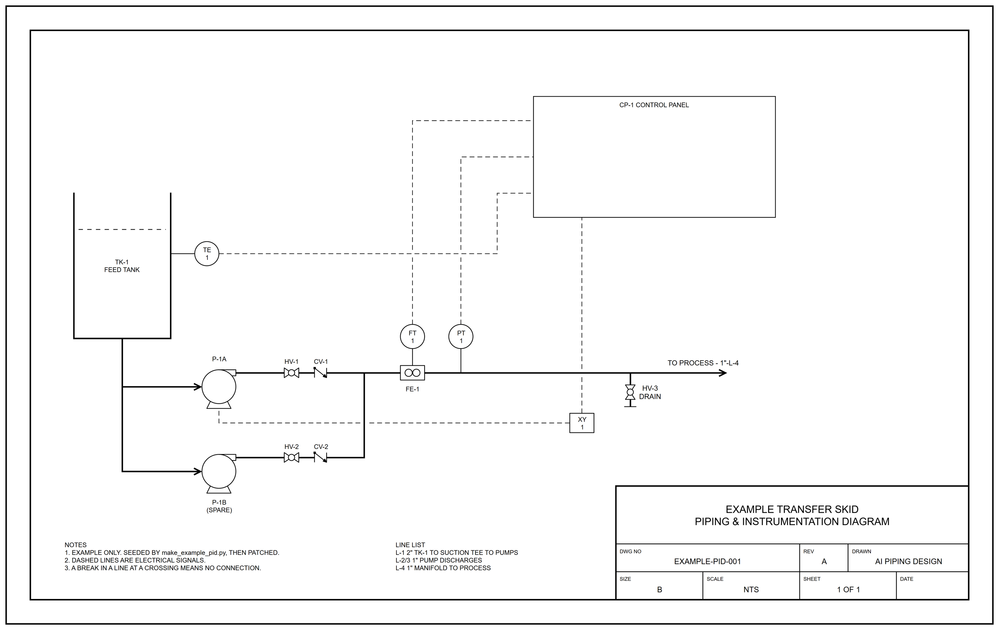

# AI P&ID

An agent skill and a symbol library for drawing P&IDs (piping and
instrumentation diagrams) as draw.io files, which can then be further edited manually.

Generating a P&ID from code is easy. Keeping it editable is the hard part:
once someone has dragged things into place, regenerating the drawing throws
their work away. This repo splits the job:

1. **The agent seeds the drawing.** A short Python script lays the sheet out
   from a symbol catalogue and writes a `.drawio` file. Every line is glued to
   a named port on its symbol, and every cell's ID is its tag (`HV-101`,
   `PT-102`, `L-006`).
2. **You edit it in [draw.io](https://www.drawio.com/)** (diagrams.net,
   Apache-2.0, free). Drag a pump and its lines follow; edit tags and notes in
   place; drag new symbols in from the custom library.
3. **The agent patches it** when the design changes. It edits cells by ID and
   leaves your layout alone, then checks that every line still lands on a real
   port.
4. **Export** to PDF, SVG and PNG with the draw.io command line.



## Contents

| Path | What it is |
|---|---|
| [`skills/pid-diagram/SKILL.md`](skills/pid-diagram/SKILL.md) | The skill: the rules, the library API, seeding, patching, line crossings, export and verification |
| [`pid/`](pid/README.md) | The library: symbol catalogue (`pid_symbols.py`), draw.io writer and patcher (`pid_drawio.py`), generated SVGs, and a draw.io custom library |
| [`examples/pid_drawio_example/`](examples/pid_drawio_example/make_example_pid.py) | Worked example: seed a small skid P&ID, patch it (insert a drain), export it |
| [`tests/`](tests/) | Stdlib unit tests for the writer and patcher, and repo policy checks |

## House style

The symbols follow company standards, which are easy to change in
[`pid/pid_symbols.py`](pid/pid_symbols.py):
- **Ball valve:** a bowtie with an opaque white circle on top.
- **Check valve:** two bars with a hinged arrow.
- **Instruments:** ISA 5.1 bubbles.
- **Line crossings:** a gap, never a bump, and a process line is never the one
  broken.

  Additional symbols can be added for additional component types as needed.

The contact sheet is in [`pid/README.md`](pid/README.md).

## Prerequisites

| | |
|---|---|
| Python 3.9+ | stdlib only |
| [draw.io desktop](https://github.com/jgraph/drawio-desktop/releases) | the editor, and the CLI for export. On Windows: `winget install JGraph.Draw` |

## Installing the skill

This repo is a Claude Code plugin marketplace. In Claude Code:

```
/plugin marketplace add petermaginot/AI_PID
/plugin install ai-pid@ai-pid
```

Without the plugin, open this repo and the agent finds the skill through
[`AGENTS.md`](AGENTS.md). Install the whole repository, not just the skill
folder: the skill uses the library in `pid/` and points at the worked example.

To use the library from another project, put `<this repo>/pid` on `sys.path`.
The example does this. A project can point at its checkout with an
environment variable such as `AI_PID_PATH`.

## Tests

```
python -m unittest discover -s tests
```

## Related

[AI_Piping_Design](https://github.com/petermaginot/AI_Piping_Design) has skills
for 3D piping models in FreeCAD (Quetzal), TechDraw fabrication drawings and
construction isometrics, Draft artwork, animations, and models from 3D scans.
