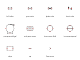

# P&ID symbol library

Reusable P&ID symbols, and the Python that writes and patches draw.io
(diagrams.net) P&IDs the user edits by hand. The
[`pid-diagram`](../skills/pid-diagram/SKILL.md) skill says how to use it; the
worked example is
[`examples/pid_drawio_example/`](../examples/pid_drawio_example/make_example_pid.py).
This file is the catalogue.

Red dots on the contact sheet are the named ports.

| File | What it is |
|---|---|
| [`pid_symbols.py`](pid_symbols.py) | The catalogue (SVG geometry and ports, in one place), `port()`, `write_svgs()` |
| [`pid_drawio.py`](pid_drawio.py) | `Diagram` (write a new .drawio), `DrawioFile` (patch an existing one by cell ID, `check()`), `ansi_b_sheet()`, and `library()` for the custom library |
| [`symbols/pid_library.xml`](symbols/pid_library.xml) | draw.io custom library: in draw.io, File → Open Library, then drag symbols in. Their ports are connection points |
| [`symbols/`](symbols/) | Generated SVGs, one per symbol, plus `_sheet.svg`. Don't edit these by hand |

## Conventions

- **Units and frame.** Symbols are drawn in mm, Y up, about an anchor at
  (0, 0). Each SVG's viewBox is symmetric about the anchor, so the anchor is
  the centre of the draw.io shape. Rotation is counter-clockwise degrees
  (draw.io `rotation=-rot`), and draw.io rotates the connection points with
  the shape. It rotates the label too, so tag a rotated symbol with separate
  text.
- **Ports.** In draw.io, the ports are the shape's connection points, and
  `Diagram.edge()` glues line ends to them by name. `port(name, x, y, which,
  rot)` gives a port's sheet coordinates, for laying out waypoints.
- **Opaque symbols.** Bubbles, boxes, the pump casing and the ball-valve
  circle are filled white, so a line end beneath them is hidden.
- **Line weights** (`pid_drawio.LINE`): process 0.6 mm, symbols and taps
  0.3 mm, signals 0.25 mm dashed.
- **Crossings.** A process line never breaks. Otherwise the line that runs
  vertically on the page breaks. draw.io draws the gap on the edge later in
  z-order, so the order cells are written in decides it (skill §5).
- **Symbol identity.** Symbol cells carry `pidSymbol=<name>` in their style,
  so `DrawioFile` knows which catalogue entry, and so which ports, a cell
  uses.

## House style

| Symbol | Drawn as |
|---|---|
| Ball valve | Bowtie with an opaque white circle on top |
| Check valve | Two short bars, with a hinged arrow from a filled pivot dot (top left) to the foot of the downstream bar. Flow runs `in` → `out` |
| Globe valve | Bowtie with a solid dot |
| Gate / generic valve | Plain bowtie |
| Centrifugal pump | Casing circle, tangential top discharge nozzle, base. The `motor` port takes the power or relay signal |
| Oval-gear meter | Box with two gears |
| Instruments | ISA 5.1 bubble: plain for field mounted, with a horizontal bar for panel mounted |

## Adding a symbol

1. Add an entry to `CATALOGUE` in `pid_symbols.py`: the SVG body (mm, Y up,
   about the anchor), the half-extents, the ports and a one-line description.
2. Run `python pid/pid_symbols.py` and `python pid/pid_drawio.py` to regenerate `symbols/`
   and the draw.io library.
3. Look at `symbols/_sheet.svg`. Check that the ports sit on the outline
   and that the fills cover only what they should.
